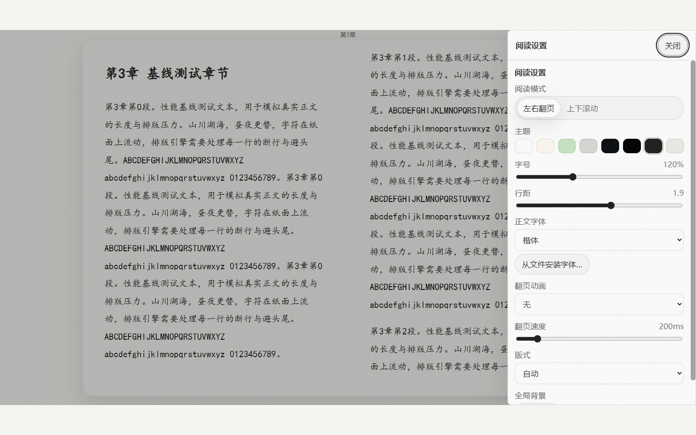
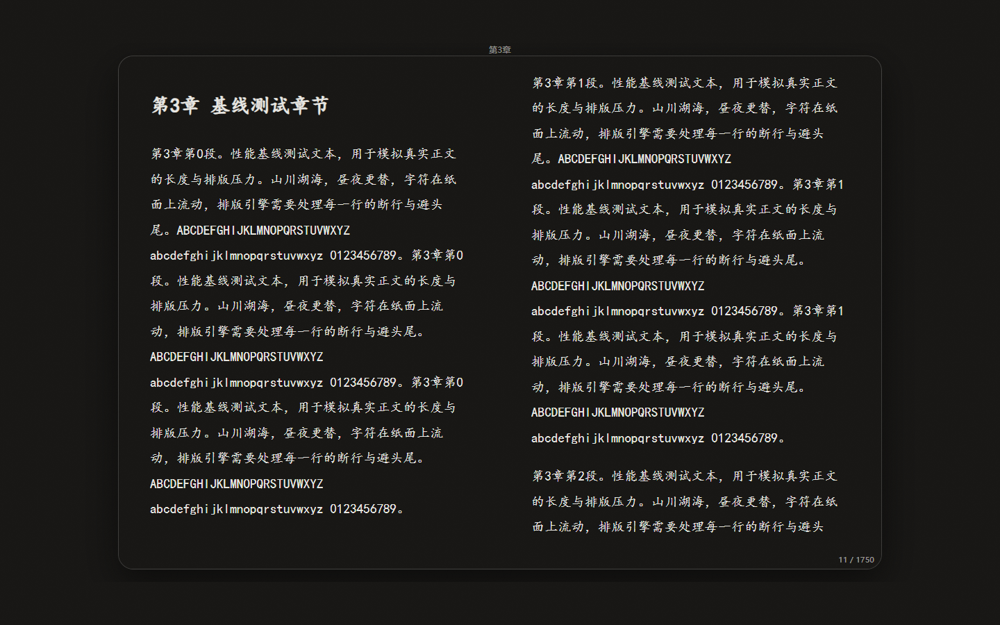

# BookReading


Windows 桌面全格式阅读器（Tauri + React + Rust）：EPUB / TXT / 漫画文件夹·CBZ / PDF，一个应用读完全部藏书；v3.0 起支持登录 wenku8 账号，把云端轻小说书架整本拉取到本地阅读。书籍、进度、笔记全部存在本机；云书架仅在登录后访问你的个人账号数据。

v2.5.0 起全新「碳墨刊头」界面：默认**纸墨**主题（米白纸底 × 碳墨单墨），另有**墨夜**与原六主题共 8 套可选，书架、弹窗、正文三处同步换墨。

**v2.6.0**：书库管理大升级（右键菜单 / 一键真删到回收站 / 打开所在位置 / 书库体检）、插图多的 EPUB 性能根治（自动优化副本）、排版细项 + 按书记忆、内置朗读（TTS）。

**v2.7.0**：回收站与收藏页批量操作、搜索与文件夹联动、阅读状态可自定（手动标未读/在读/已读）、大部头打开守卫（自动生成优化副本不再冻结）、书内插图点击放大、媒体面板（EPUB 内嵌音视频点播）、应用内一键更新、导入三模式（复制/移动/引用）、关闭行为记忆、主题跟随系统、启动自动备份数据库、CI 云端构建发布。

**v2.8.0**：继续阅读快捷卡（书架首页一键回到上次在读）、目录当前章高亮+自动滚动、按作者排序、详情页直接删除、布局跳动修复。

**v2.9.0**：侧栏书架树折叠、Shift 范围多选、智能标题清洗（实体/标签/水印/双语一键理清）、鼠标侧键逻辑回溯。

**v3.0.1**：**wenku8 云书架**——登录即同步云端书架，书卡详情（简介/目录/标签）选书架整本拉取入库（封面/标签/简介落库、已入库去重、有新章提示），收藏序/最近更新排序，顶栏搜索过滤；切页闪烁根治（侧栏壳常驻）、底部动作区四钮全局固定、四视图顶栏与上下文行统一、继续阅读改紧凑索引行（可开关）。

**v3.1**：**应用内更新**（签名清单 / 下载进度条 / 一键升级）、安装包 290MB → 约 6MB、无边框自定义标题栏与全局分区右键菜单、目录卷章分层折叠、wenku8 地址与代理设置。

**v3.1.9**：**设置改为居中浮窗**（左侧分类 + 右侧配置，八个分区即改即存，新增 EPUB / 漫画 / PDF 默认阅读设置）；书库体检支持**勾选批量处理**（只确认一次）并显示重复导入各份的位置；修复同一本书再次打开时章内插图丢失、窗口右缘多出的一道底色。

## 界面

| 书架 · 刊头与工具行 | 阅读器 · 纸墨 |
| --- | --- |
|  |  |

| 阅读设置 · 抽屉 | 墨夜主题 |
| --- | --- |
|  |  |

> 截图为运行中的真实应用（为保护演示书库隐私，正文使用合成测试书）。

## v3.1 更新

**v3.1.9 · 设置浮窗与书库体检**
- **设置浮窗**：侧栏「设置」打开居中浮窗，左侧分区目录、右侧配置面板，点遮罩或按 Esc 关闭，底下的书架保持原状。八个分区：外观 / 阅读 / 书库 / 云书架 / 网络与更新 / 快捷键 / 漫画增强 / 关于，更改即时保存
- **默认阅读设置**：EPUB 的阅读模式、翻页动画、字体与排版；漫画与 PDF 的阅读模式、适配、单双页、阅读方向等，均可在此设为新书默认（阅读页里按书调过的设置仍优先）
- **书库体检**：弹窗放大；失链与重复导入可逐条勾选或「全选」，在底栏一次处理、**只确认一次**（失链 = 从电脑删除，重复项 = 移入书库回收站）；重复导入按「份」列出位置、所在书架、大小与导入时间，方便决定保留哪一份
- 修复：同一本书退出后再打开，章内插图与内嵌字体丢失（自 v2.9.0 起）
- 修复：窗口右缘多出的一道底色；圆角弹窗的滚动条不再压进圆角

**v3.1.0 · 更新系统与桌面纯化**
- **应用内更新**：签名清单校验、下载进度条、一键安装并重启；安装包 290MB → 约 6MB
- **网络设置**：wenku8 地址三选（自动 / 中继 / 直连）与连通探测、代理配置
- **桌面纯化**：无边框自定义标题栏、全局分区右键菜单、文字防误选、界面字体统一
- **阅读**：目录卷章分层折叠、侧栏三段布局、正文边距自适应
- v3.1.8：修复安装版正文字体 / 排版 / 插图显示异常

## v3.0.1 更新

**wenku8 云书架**
- **登录即同步**：设置侧「云书架」登录 wenku8 账号（账密仅存本机），云端书架一键投射到桌面；上下文行显示账号与同步时间，可退出 / 切换
- **书卡详情**：完整书名 / 作者 / 状态 / 简介全文 / 卷章目录 / 标签，一键直开网页版
- **拉取到书库**：详情内选目标书架（下拉内可直接**新建书架**）→ 整本并发拉取（逐章进度）→ 自动入库；封面、简介、标签一并落库（标签直接进本地标签系统，可筛选）
- **去重与更新**：已入库显示徽标一键打开；连载书自动比对，有新章节显示「有新章」
- **排序 / 密度 / 搜索**：收藏顺序 / 最近更新 / 书名排序；密度与书架同一设置联动；顶栏搜索框即时过滤

**界面与体验**
- 切换书架 / 收藏 / 云书架 / 回收站时侧栏与底部按钮**零重挂载**（闪烁根治）
- 侧栏底部「刷新 / 导入漫画 / 导入图书 / 设置」四钮全局常驻，导入自动落当前书架
- 四视图顶栏统一（标题同字号、搜索框恒定位）；侧栏上下文行同高各显其用
- 继续阅读改为紧凑索引行，设置中可开关
- 修复：TXT 导入封面丢失、epub 内嵌标题与书架不同源、设置弹窗滚动异常等

## v2.7.0 更新

**书库管理**
- **回收站批量**：多选/全选/批量恢复/彻底删除/从电脑删除，一次确认处理 N 本；键盘 Delete 直达
- **收藏页全面升级**：与书架同款书卡（⋯ 菜单/右键/拖动归架/密度/进度墨线）、批量取消收藏与移动、摘录右键（复制/定位/删除）
- **搜索与文件夹联动**（资源管理器式）：文件夹按命中过滤显示"N 命中"角标；命中的书显示所属书架路径
- 置顶书浮到最顶；文件夹独立排序；嵌套书架显示含子孙总数；导入三模式（**复制/移动/原地引用**）
- 关闭行为可记忆；数据库启动自动备份（保留 3 份）

**阅读器**
- **大部头守卫**：超大书自动生成优化副本（剥离内嵌音视频 + 重编码），显示进度不再冻结
- **书内插图点击放大**：全屏缩放/平移；**媒体面板**：EPUB 内嵌音视频逐条点播
- **阅读状态自定**：菜单直接标 未读/在读/已读（手动优先）；计时失焦即停（最小化不计）
- **「设为我的默认」**：当前排版一键存为新书默认；「本书恢复默认」随时回退
- 主题跟随系统；抽屉记忆；修复分页模式内嵌图不加载的回归

**应用维护**
- **应用内更新**：设置→关于一键检查下载安装（自动尝试本地代理）；启动静默检查（红点提醒）
- CI 云端构建：tag 推送自动出安装包挂 Release

## v2.6.0 更新

**书库管理**
- **右键书卡 = ⋯ 同款菜单**；菜单里直接**「从电脑删除」**——源文件/漫画源文件夹真实移入 Windows 回收站（系统回收站可找回）
- **打开所在位置**：一键在资源管理器中定位源文件/源目录
- **书库体检**：一键查重复导入、源目录失链（可直接重新链接）、悬空封面
- 书架滚动位置记忆、收藏页标签记忆、排序与过滤状态持久化

**插图多的 EPUB 性能根治**
- 导入时自动生成"阅读优化副本"：大插图缩到 1520px、注入宽高（翻页不跳版）、懒加载；原书保留，存量书后台自动补生成

**阅读器**
- 排版细项：字重 / 字间距 / 段间距 / 首行缩进 / 页边距 / 两端对齐（默认中性，存量书观感不变）
- 排版按书记住（epuset 书级覆盖）
- 内置朗读（系统语音，语速可调，翻章自停）
- 全局背景纱浓度可调；修复 v2.5.0 自定义字体未真正注入正文的隐性缺陷

## v2.5.0 更新

**性能（实测对比 v2.1.0，同机同库）**

- 书架滚动卡顿帧 61 本采样：11 → **0**（最长掉帧 394ms → 18ms）
- 条漫连续滚动 p95 帧间隔 24.3ms → **6.2ms**；漫画翻页最长掉帧 54ms → **12ms**
- EPUB 拖字号整章重排 0.3s → **0.1s**，拖动过程零白闪
- 封面全面走 480px 缩略档；漫画页列表/压缩包句柄缓存、按显示尺寸降采样；全部后端命令并发化；SQLite WAL + 索引
- EPUB 开书首显直达进度位置；厚书进度条结果持久化（同字体字号二次开书秒就绪）；自定义字体真正注入正文
- 窗口记住大小与位置

**新功能**：划选一键复制；漫画方向/双页/适配/条漫宽度/双页偏移**按书记住**；阅读时长统计（书卡显示「已读 X 小时」）；标注与收藏摘录导出 Markdown；书库搜索跨书架全库命中；字号快捷键 Ctrl+= / - / 0；页面面板定位当前页 + 页码直达；高亮原文与笔记分列（存量自动迁移）。

**界面「碳墨刊头」**：书架刊头大字排印 + 等宽统计列；工具行图标化（排序收纳下拉、密度三格分段）；书卡封面墨线描边、在读进度为封面下缘 2px 墨线；印刷感细节（纸底噪点、尾注线、骨架 shimmer）；阅读器顶/底栏纸墨毛玻璃；720px 起三档自适应断点。

## 功能总览

### 格式与阅读
- 四种格式统一入口：EPUB、TXT（自动探测 GBK/UTF-8/UTF-16 编码，legado 规则池自动分章）、漫画文件夹与 CBZ（Webtoon 连续滚动）、图片型 PDF 按漫画交互（条漫/页漫），阅读设置与漫画各自独立记忆
- 翻页 / 滚动双阅读模式；单双栏分栏（含日漫封面独占的双页偏移）；RTL（日漫从右向左）；横图跨页检测
- 八套主题：纸墨（默认）/ 墨夜 / 浅色 / 纸黄 / 护眼绿 / 灰 / 暗色 / 高对比暗色，全局即时切换，另可设置自定义背景图与自定义正文字体（ttf/otf/woff2）
- 字号 / 行距 / 字体（宋 / 黑 / 楷 / 仿宋 / 默认悦读栈）自由调节；翻页动画速度可调（150–600ms）
- 页码显示：EPUB 章内页码 + 全局估算页码；漫画与 PDF 显示第 N / 总页
- 沉浸模式：Ctrl+D 锁定全藏界面，鼠标活动不唤出；F11 窗口全屏独立开关
- 漫画：Ctrl+滚轮 0.5–4x 缩放（光标锚点）、拖拽平移、条漫宽度三档 + 自定义、自动滚动（空格播放，方向键调速）
- 划线高亮 / 书签（含章节标题）/ 收藏句子 / 划选复制 / 书内全文搜索（结果带章节标题与百分比，一键跳转）；内置朗读（TTS）与排版细项（字重/字间距/段距/缩进/页边距/两端对齐），排版按书记忆【v2.6.0】


### wenku8 云书架【v3.0.1】
- 登录 wenku8 账号同步云端书架（账密仅存本机）；书卡详情（简介 / 目录 / 标签 / 网页版入口）
- 整本拉取入库：并发下载 + 逐章进度 + 封面 / 简介 / 标签落库；已入库去重 + 「有新章」提示；收藏序 / 最近更新 / 书名排序

### 书库管理
- 层级书架（无限嵌套，侧栏树形导航 + 快捷过滤「全部藏书/在读/未读」，面包屑定位，拖拽归架）
- 标签系统：8 色标签、多选 AND 筛选、批量打标、标签合并；书库体检（重复/失链/悬空封面，勾选批量处理、只确认一次）【v2.6.0 / v3.1.9】
- 回收站：删除先入回收站，7 天 / 30 天 / 永不三种保留期；可恢复、彻底删除（只清书库记录），或「**从电脑删除**」把源文件 / 漫画源文件夹移入 Windows 回收站（文件夹漫画为原地引用，彻底删除不动源目录，从电脑删除才会真删）；书与书架卡可拖到侧栏“回收站”直接删除（回收站页内不启用）
- 批量操作：多选移动 / 收藏 / 删除 / 打标签
- 排序（最近阅读 / 书名 / 导入时间 / 自定义 × 升降序）、阅读状态筛选、搜索（书名 + 文件名，跨书架全库）
- 书籍详情页：编辑标题 / 作者 / 简介，阅读时长 / 格式 / 大小 / 进度 / 书架路径，一键更换自定义封面
- 卡片密度三档（标准 / 宽松 / 特大）、书架四宫格封面缩略

### 导入
- 文件多选导入（EPUB / TXT / PDF）；父目录一键批量导入漫画（每个子文件夹一本书）
- 漫画元数据：文件夹 / CBZ 名形如“[作者] 标题”自动拆分作者与标题（前导“(汉化组)”段忽略；无中括号按原名导入）
- 拖入窗口即导入（支持文件与目录，绝对路径直取）
- 自动查重（文件名 / 标题 + 字节数），四类结果汇总：成功 / 已存在 / 疑似重复 / 失败原因；单本导入命中疑似重复时询问是否导入副本，批量跳过项可一键补齐全部副本
- 壳级进度条：第 i / N 本 + 当前书名

### 存储与导出
- 书库根目录可迁移（空间预检、复制式迁移、失败自动回滚），迁移完成后可一键删除旧位置文件释放空间
- 占用统计：书籍 / 封面 / 背景图 / 数据库 / 日志分类列表；一键清理：封面缓存、背景图、运行日志
- 标注与收藏摘录一键导出 Markdown（单书 / 全库）

### 窗口与托盘
- 窗口记住大小与位置；点 ✕ 弹三选：最小化到系统托盘 / 退出 / 取消；托盘左键恢复，右键菜单“显示主窗口 / 退出”
- 设置浮窗：八个分区即改即存（外观 / 阅读 / 书库 / 云书架 / 网络与更新 / 快捷键 / 漫画增强 / 关于）【v3.1.9】

## 快捷键

| 场景 | 按键 | 作用 |
| --- | --- | --- |
| 阅读 | ← / → / PgUp / PgDn | 翻页（漫画 RTL 下方向语义反转） |
| 阅读 | 滚轮 | 滚动阅读 / 翻页 |
| 阅读 | 空格 | 条漫模式：自动滚动播放 / 暂停 |
| 阅读 | ↑ / ↓ | 自动滚动播放中：速度 ±10px/s |
| 阅读 | Esc | 关抽屉 → 解除界面锁定 → 唤醒工具栏 |
| 全局 | F11 | 窗口全屏开关（书架 / 阅读页通用，独立于沉浸锁定） |
| 阅读 | Ctrl+F | 书内搜索（EPUB） |
| 阅读 | Ctrl+B | 在当前位置加书签 |
| 阅读 | Ctrl+D | 锁定 / 解锁界面 |
| 阅读 | Ctrl+= / Ctrl+- / Ctrl+0 | 字号放大 / 缩小 / 重置 |
| 阅读 | Ctrl+滚轮 / 双击 | 漫画缩放 / 复位缩放 |
| 阅读 | PDF | 与漫画一致（连续滚动支持空格自动滚动） |
| 书库 | Enter / Space | 打开选中的书或书架 |
| 书库 | Tab | 在书与书架间移动焦点 |
| 书库 | 右键 | 上下文菜单 |
| 书库 | 拖拽 | 把书移入书架（含批量）、书 / 书架拖到“回收站”删除 |

## 安装

从 [Releases](../../releases/latest) 下载 NSIS 安装包（如 `bookreading_3.1.9_x64-setup.exe`，以 Releases 最新为准），双击安装即可。安装包约 6MB；系统缺少 WebView2 运行时（Windows 10 / 11 一般已自带）时安装程序会联网补装。升级安装保留书库与全部数据（升级前建议备份 `%APPDATA%\com.root.bookreading`）。

## 从源码构建

环境要求：Node.js 18+、Rust stable（含 Windows MSVC 工具链）。

```bash
npm install
npm run tauri dev    # 开发调试（前端 dev server 固定占用 14200 端口）
npm run tauri build  # 产出 NSIS 安装包
```

说明：

- cargo 走 rsproxy 镜像拉取 crates——项目已自带 `src-tauri/.cargo/config.toml`，无需手动配置。
- Rust 编译产物体积大，建议把构建目录重定向到大容量磁盘，避免撑爆系统盘：

```bash
CARGO_TARGET_DIR=D:/cargo-target/bookreading npm run tauri build
```

- 跑测试：`npm test`（前端 Vitest，37 文件 259 用例）与 `cd src-tauri && cargo test`（后端 147 用例）。

## 项目结构

```
bookreading/
├── src/                # React 前端
│   ├── app/            #   路由
│   ├── pages/          #   书库 / 收藏 / 云书架 / 阅读器页面
│   ├── library/        #   书架、标签、导入、封面、密度
│   ├── reader/         #   epub / image / pdf 三类阅读器与设置
│   ├── tauri/          #   invoke 封装与前端日志
│   └── ui/             #   AppShell、主题、图标、对话框、设置
├── src-tauri/          # Rust 后端（SQLite 书库、导入转换、缩略图管线、导出）
│   └── .cargo/         #   rsproxy 镜像配置
└── docs/               # 设计规范、批次记录、性能基线与验收证据
```

## 已知限制

- 云书架依赖 wenku8 第三方公益中继（wenku8-relay.mewx.org），其可用性不受本应用控制；已拉取到本地的书不受影响

- PDF：文本搜索与划线标注暂不可用，仅支持阅读 / 跳页 / 缩放 / 书签；受密码保护的 PDF 暂不支持。
- EPUB 全局页码为位置估算（按 1024 字/页折算），章内页码准确。
- 条漫深度恢复为近似落位（恢复到最近渲染锚点，不逐像素还原）。
- mobi / azw3 暂不支持（纯 Rust 生态暂无可用的 KF8 解析方案，评估记录见 `docs/superpowers/plans/`）。

## 致谢

- [epub.js](https://github.com/futurepress/epub.js)：EPUB 渲染内核
- [pdf.js](https://github.com/mozilla/pdf.js)：PDF 渲染内核
- [legado](https://github.com/gedoor/legado)：TXT 分章规则池参考
- 交互参考微信读书桌面版；v2.5.0「碳墨刊头」视觉为本项目自有设计

## 许可

[MIT](./LICENSE) Copyright (c) 2026 2019xiaopeng。所依赖的开源组件（epub.js、pdf.js、Tauri 及各 crate）著作权归其作者所有。
