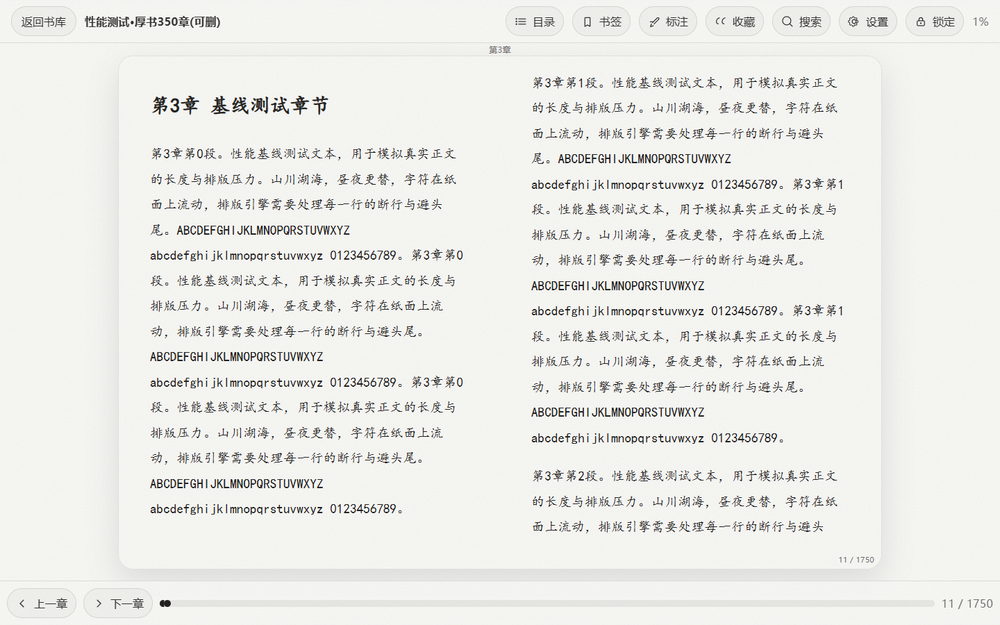
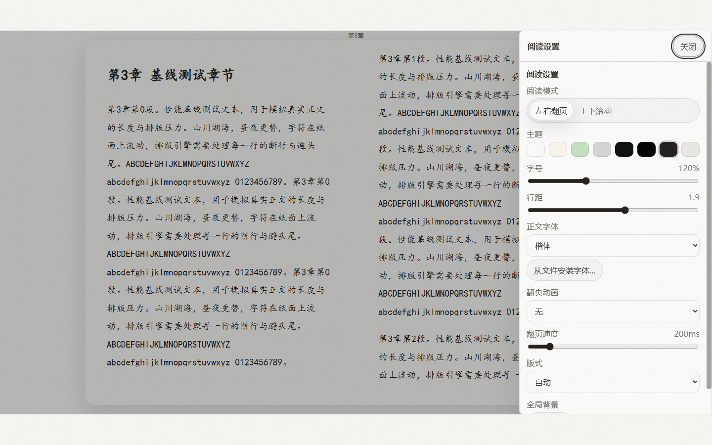
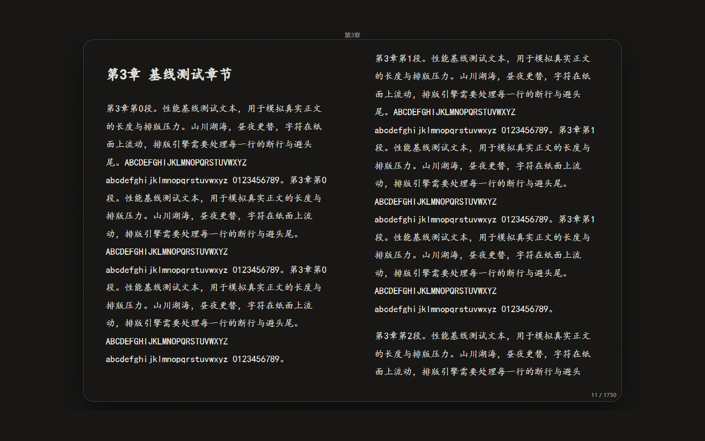

# BookReading


Windows 桌面全格式阅读器（Tauri + React + Rust）：EPUB / TXT / 漫画文件夹·CBZ / PDF，一个应用读完全部本地藏书。书籍、进度、笔记全部存在本机，不联网、无账号。

v2.5.0 全新「碳墨刊头」界面：默认**纸墨**主题（米白纸底 × 碳墨单墨），另有**墨夜**与原六主题共 8 套可选，书架、弹窗、正文三处同步换墨。

## 界面

| 书架 · 刊头与工具行 | 阅读器 · 纸墨 |
| --- | --- |
|  |  |

| 阅读设置 · 抽屉 | 墨夜主题 |
| --- | --- |
|  |  |

> 截图为运行中的真实应用（为保护演示书库隐私，正文使用合成测试书）。

## v2.5.0 更新

**性能（实测对比 v2.1.0，同机同库）**

- 书架滚动卡顿帧 61 本采样：11 → **0**（最长掉帧 394ms → 18ms）
- 条漫连续滚动 p95 帧间隔 24.3ms → **6.2ms**；漫画翻页最长掉帧 54ms → **12ms**
- EPUB 拖字号整章重排 0.3s → **0.1s**，拖动过程零白闪
- 封面全面走 480px 缩略档；漫画页列表/压缩包句柄缓存、按显示尺寸降采样；全部后端命令并发化；SQLite WAL + 索引
- EPUB 开书首显直达进度位置；厚书进度条结果持久化（同字体字号二次开书秒就绪）；自定义字体真正注入正文
- 窗口记住大小与位置

**新功能**：划选一键复制；漫画方向/双页/适配/条漫宽度/双页偏移**按书记住**；阅读时长统计（书卡显示「已读 X 小时」）；标注与收藏摘录导出 Markdown；书库搜索跨书架全库命中；字号快捷键 Ctrl+= / - / 0；页面面板定位当前页 + 页码直达；高亮原文与笔记分列（存量自动迁移）。

**界面「碳墨刊头」**：书架刊头大字排印 + 等宽统计列；工具行图标化（排序收纳下拉、密度三格分段）；书卡封面墨线描边、在读进度为封面下缘 2px 墨线；印刷感细节（纸底噪点、尾注线、骨架 shimmer）；阅读器顶/底栏纸墨毛玻璃；720px 起三档自适应断点。

## 功能总览

### 格式与阅读
- 四种格式统一入口：EPUB、TXT（自动探测 GBK/UTF-8/UTF-16 编码，legado 规则池自动分章）、漫画文件夹与 CBZ（Webtoon 连续滚动）、图片型 PDF 按漫画交互（条漫/页漫），阅读设置与漫画各自独立记忆
- 翻页 / 滚动双阅读模式；单双栏分栏（含日漫封面独占的双页偏移）；RTL（日漫从右向左）；横图跨页检测
- 八套主题：纸墨（默认）/ 墨夜 / 浅色 / 纸黄 / 护眼绿 / 灰 / 暗色 / 高对比暗色，全局即时切换，另可设置自定义背景图与自定义正文字体（ttf/otf/woff2）
- 字号 / 行距 / 字体（宋 / 黑 / 楷 / 仿宋 / 默认悦读栈）自由调节；翻页动画速度可调（150–600ms）
- 页码显示：EPUB 章内页码 + 全局估算页码；漫画与 PDF 显示第 N / 总页
- 沉浸模式：Ctrl+D 锁定全藏界面，鼠标活动不唤出；F11 窗口全屏独立开关
- 漫画：Ctrl+滚轮 0.5–4x 缩放（光标锚点）、拖拽平移、条漫宽度三档 + 自定义、自动滚动（空格播放，方向键调速）
- 划线高亮 / 书签（含章节标题）/ 收藏句子 / 划选复制 / 书内全文搜索（结果带章节标题与百分比，一键跳转）

### 书库管理
- 层级书架（无限嵌套，侧栏树形导航 + 快捷过滤「全部藏书/在读/未读」，面包屑定位，拖拽归架）
- 标签系统：8 色标签、多选 AND 筛选、批量打标、标签合并
- 回收站：删除先入回收站，7 天 / 30 天 / 永不三种保留期，可恢复或彻底删除；书与书架卡可拖到侧栏“回收站”直接删除（回收站页内不启用）
- 批量操作：多选移动 / 收藏 / 删除 / 打标签
- 排序（最近阅读 / 书名 / 导入时间 / 自定义 × 升降序）、阅读状态筛选、搜索（书名 + 文件名，跨书架全库）
- 书籍详情页：编辑标题 / 作者 / 简介，阅读时长 / 格式 / 大小 / 进度 / 书架路径，一键更换自定义封面
- 卡片密度三档（标准 / 宽松 / 特大）、书架四宫格封面缩略

### 导入
- 文件多选导入（EPUB / TXT / PDF）；父目录一键批量导入漫画（每个子文件夹一本书）
- 漫画元数据：文件夹 / CBZ 名形如“[作者] 标题”自动拆分作者与标题（前导“(汉化组)”段忽略；无中括号按原名导入）
- 拖入窗口即导入（支持文件与目录，绝对路径直取）
- 自动查重（文件名 / 标题 + 字节数），四类结果汇总：成功 / 已存在 / 疑似重复 / 失败原因；单本导入命中疑似重复时询问是否导入副本，批量跳过项可一键补齐全部副本
- 壳级进度条：第 i / N 本 + 当前书名

### 存储与导出
- 书库根目录可迁移（空间预检、复制式迁移、失败自动回滚），迁移完成后可一键删除旧位置文件释放空间
- 占用统计：书籍 / 封面 / 背景图 / 数据库 / 日志分类列表；一键清理：封面缓存、背景图、运行日志
- 标注与收藏摘录一键导出 Markdown（单书 / 全库）

### 窗口与托盘
- 窗口记住大小与位置；点 ✕ 弹三选：最小化到系统托盘 / 退出 / 取消；托盘左键恢复，右键菜单“显示主窗口 / 退出”

## 快捷键

| 场景 | 按键 | 作用 |
| --- | --- | --- |
| 阅读 | ← / → / PgUp / PgDn | 翻页（漫画 RTL 下方向语义反转） |
| 阅读 | 滚轮 | 滚动阅读 / 翻页 |
| 阅读 | 空格 | 条漫模式：自动滚动播放 / 暂停 |
| 阅读 | ↑ / ↓ | 自动滚动播放中：速度 ±10px/s |
| 阅读 | Esc | 关抽屉 → 解除界面锁定 → 唤醒工具栏 |
| 全局 | F11 | 窗口全屏开关（书架 / 阅读页通用，独立于沉浸锁定） |
| 阅读 | Ctrl+F | 书内搜索（EPUB） |
| 阅读 | Ctrl+B | 在当前位置加书签 |
| 阅读 | Ctrl+D | 锁定 / 解锁界面 |
| 阅读 | Ctrl+= / Ctrl+- / Ctrl+0 | 字号放大 / 缩小 / 重置 |
| 阅读 | Ctrl+滚轮 / 双击 | 漫画缩放 / 复位缩放 |
| 阅读 | PDF | 与漫画一致（连续滚动支持空格自动滚动） |
| 书库 | Enter / Space | 打开选中的书或书架 |
| 书库 | Tab | 在书与书架间移动焦点 |
| 书库 | 右键 | 上下文菜单 |
| 书库 | 拖拽 | 把书移入书架（含批量）、书 / 书架拖到“回收站”删除 |

## 安装

从 [Releases](../../releases/latest) 下载 NSIS 安装包（`bookreading_2.5.0_x64-setup.exe`），双击安装即可。安装包内置 WebView2 离线安装器，无需额外环境。升级安装保留书库与全部数据（数据库自动迁移，升级前建议备份 `%APPDATA%\com.root.bookreading`）。

## 从源码构建

环境要求：Node.js 18+、Rust stable（含 Windows MSVC 工具链）。

```bash
npm install
npm run tauri dev    # 开发调试（前端 dev server 固定占用 14200 端口）
npm run tauri build  # 产出 NSIS 安装包
```

说明：

- cargo 走 rsproxy 镜像拉取 crates——项目已自带 `src-tauri/.cargo/config.toml`，无需手动配置。
- Rust 编译产物体积大，建议把构建目录重定向到大容量磁盘，避免撑爆系统盘：

```bash
CARGO_TARGET_DIR=D:/cargo-target/bookreading npm run tauri build
```

- 跑测试：`npm test`（前端 Vitest，22 文件 162 用例）与 `cd src-tauri && cargo test`（后端）。

## 项目结构

```
bookreading/
├── src/                # React 前端
│   ├── app/            #   路由
│   ├── pages/          #   书库 / 收藏 / 阅读器页面
│   ├── library/        #   书架、标签、导入、封面、密度
│   ├── reader/         #   epub / image / pdf 三类阅读器与设置
│   ├── tauri/          #   invoke 封装与前端日志
│   └── ui/             #   AppShell、主题、图标、对话框、设置
├── src-tauri/          # Rust 后端（SQLite 书库、导入转换、缩略图管线、导出）
│   └── .cargo/         #   rsproxy 镜像配置
└── docs/               # 设计规范、批次记录、性能基线与验收证据
```

## 已知限制

- PDF：文本搜索与划线标注暂不可用，仅支持阅读 / 跳页 / 缩放 / 书签；受密码保护的 PDF 暂不支持。
- EPUB 全局页码为位置估算（按 1024 字/页折算），章内页码准确。
- 条漫深度恢复为近似落位（恢复到最近渲染锚点，不逐像素还原）。
- mobi / azw3 暂不支持（纯 Rust 生态暂无可用的 KF8 解析方案，评估记录见 `docs/superpowers/plans/`）。

## 致谢

- [epub.js](https://github.com/futurepress/epub.js)：EPUB 渲染内核
- [pdf.js](https://github.com/mozilla/pdf.js)：PDF 渲染内核
- [legado](https://github.com/gedoor/legado)：TXT 分章规则池参考
- 交互参考微信读书桌面版；v2.5.0「碳墨刊头」视觉为本项目自有设计

## 许可

[MIT](./LICENSE) Copyright (c) 2026 2019xiaopeng。所依赖的开源组件（epub.js、pdf.js、Tauri 及各 crate）著作权归其作者所有。
